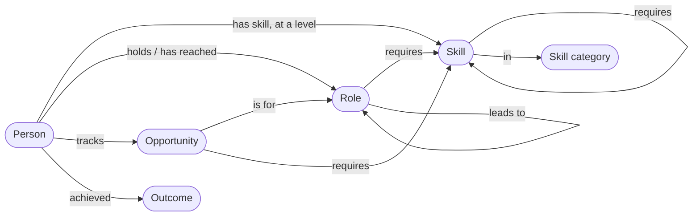
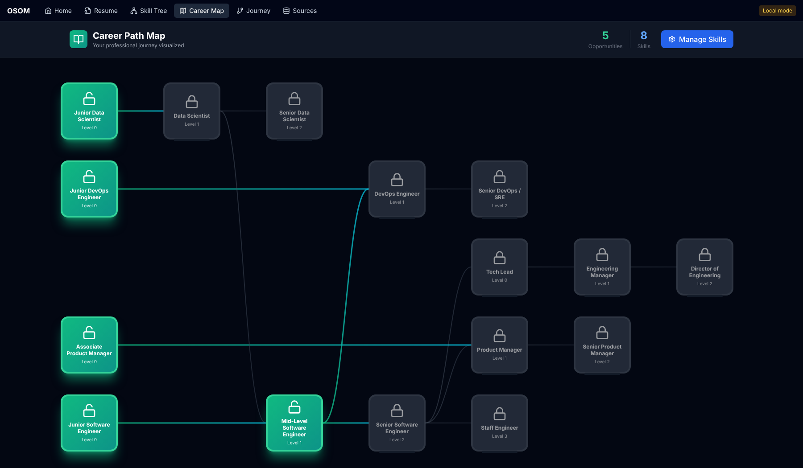
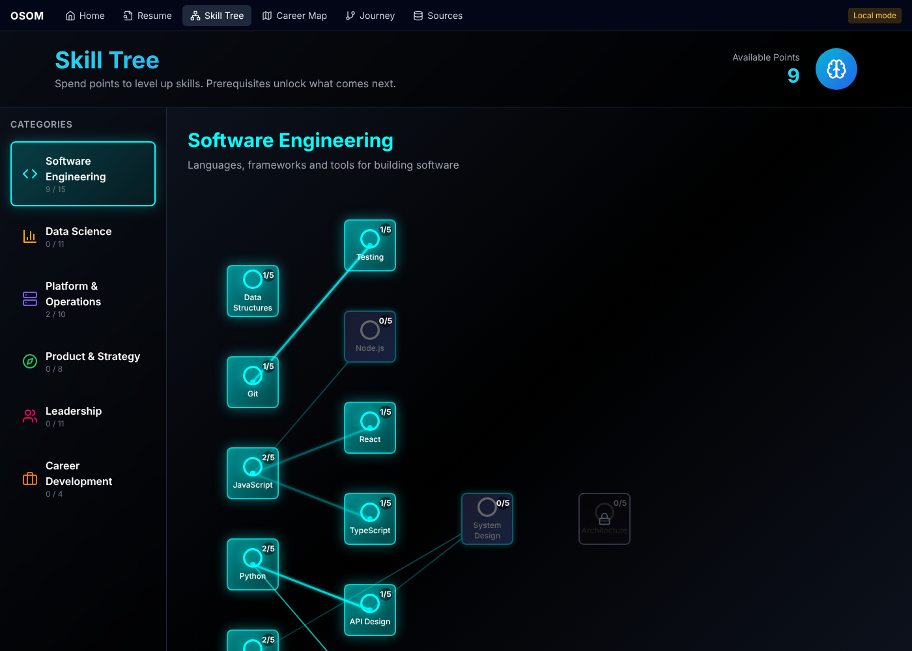
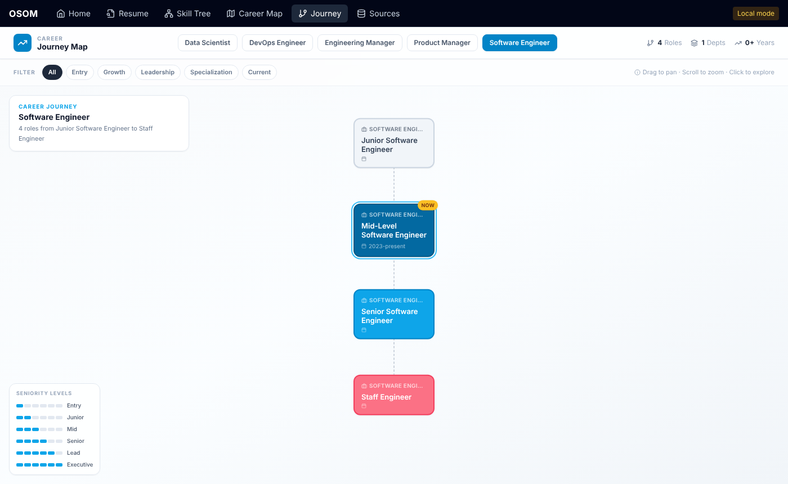
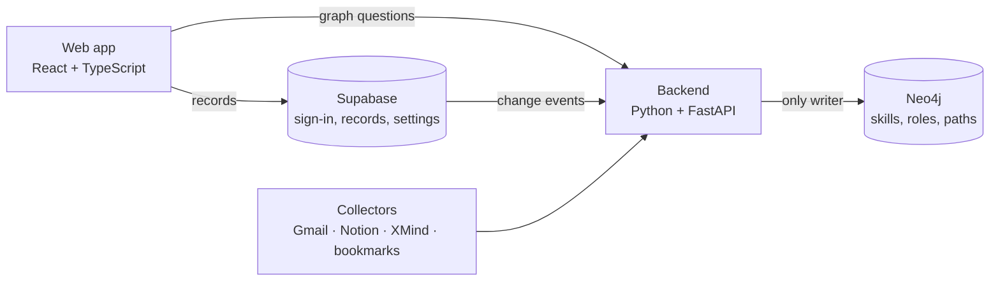

# OSOM

**Opportunity Skills Optimization Map.** OSOM helps a person see the skills
they have, the roles those skills open up, and the path from where they are
to where they want to be.

Most career tools start from job listings. OSOM starts from the person and
treats a career the way a game treats a character: skills are a tree you
level up, roles are milestones you unlock, and the map shows what each next
step requires.

> This repository is the public overview. The platform itself is developed
> in a private repository.

## The model

Everything in OSOM hangs off one chain:

**Identity → Skills → Roles → Outcomes**

- A **skill** is defined once, however it arrives: from a resume, from the
  skill tree, or from a job posting.
- A **role** is a rung on a career track. Tracks connect, so moving from
  engineering into product or management is a path like any other.
- A **career path is not stored**. It is a route through the graph, worked
  out for the person asking: what you hold, what the next role needs, and
  what is missing.

## What it looks like

### Career map
Roles as milestones. A role unlocks when you hold the skills it requires
and have reached a role that leads to it.

### Skill tree
Spend points to level up skills. Prerequisites decide what opens next.
Skills found in a resume appear here automatically.

### Career journey
Each track from first role to last, with where you are now.

## How it is built

Two stores, each for what it is good at. Records, sign-in and settings live
in a relational database. Anything that is a question about relationships
(what leads where, what is missing, how to get from one role to another)
lives in a graph. One identity key joins them, and a single service keeps
the graph in step with the records.

| Layer | Technology |
|---|---|
| Web app | React, TypeScript, Vite, Tailwind |
| Backend | Python, FastAPI |
| Graph | Neo4j |
| Records and sign-in | Supabase (Postgres) |
| Mind-map import | [xmind_converter](https://github.com/MarlinZH/xmind_converter) |

## Status

OSOM is in active development and not yet open to users.

| Area | State |
|---|---|
| Unified skill and role model in the graph | Working |
| Resume to skills to matching roles | Working (taxonomy matching) |
| Skill tree, career map, career journey | Working against the graph |
| Records-to-graph sync | Built and tested locally |
| Opportunity ingestion and matching | Backend in place, no page yet |
| Interest and work-style assessment | Planned |
| Resume generation, application tracking | Planned |
| Digital identity: owning and benefiting from your own data | Future phase |

## Related

- [xmind_converter](https://github.com/MarlinZH/xmind_converter): convert
  XMind mind maps to Markdown, CSV, Notion and Neo4j.
- [osom_website](https://github.com/MarlinZH/osom_website): landing page.
